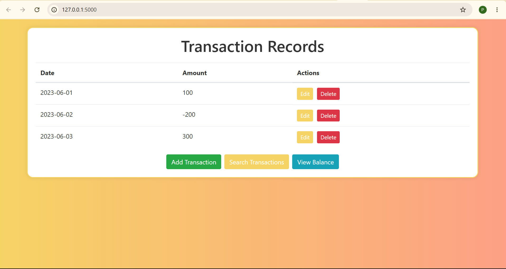
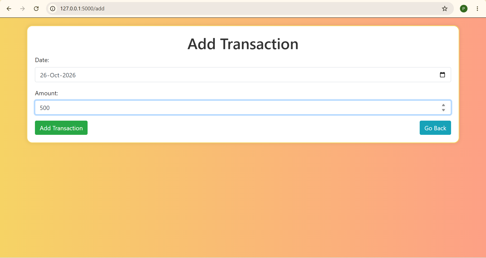
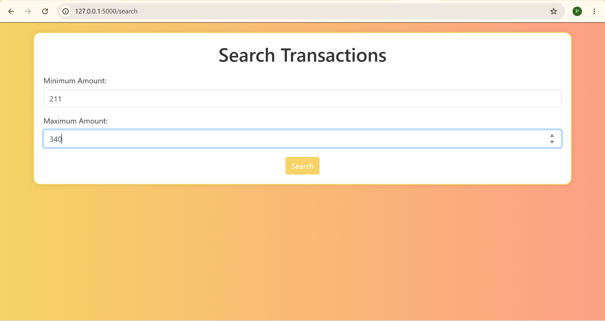
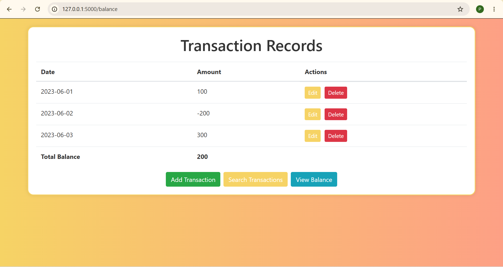

# Flask Transactions Management System

A web-based transaction management application built with Python and Flask.

The application allows users to create, view, update, delete, and search financial transactions, as well as calculate their total balance through a simple and intuitive interface.

## Features

- **Create Transactions:** Add new transactions with dates and amounts.
- **Read Transactions:** View all recorded transactions in a structured table.
- **Update Transactions:** Edit existing transaction details.
- **Delete Transactions:** Remove transactions from the records.
- **Search Transactions:** Filter transactions using minimum and maximum amounts.
- **Balance Calculation:** Calculate the combined balance of all transactions.

## Screenshots

### 1. Transaction Dashboard


### 2. Add Transaction


### 3. Search Transactions


### 4. Transaction Balance


### 5. Delete Transaction


## Technologies Used

- Python
- Flask
- HTML5
- CSS3
- Bootstrap 4
- Jinja2

## Project Structure

```text
obmnl-flask_assignment/
│
├── app.py
├── requirements.txt
├── README.md
├── .gitignore
│
├── templates/
│   ├── transactions.html
│   ├── form.html
│   ├── edit.html
│   └── search.html
│
└── screenshots/
    ├── dashboard.png
    ├── add_transaction.png
    ├── search.png
    ├── balance.png
    └── delete_transaction.png